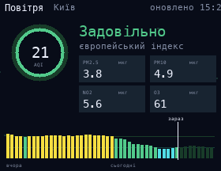

# Air Quality

Air quality in Kyiv from [Open-Meteo](https://open-meteo.com/en/docs/air-quality-api) (no API key): the European AQI with its level, PM2.5, PM10, NO2 and O3, and an hourly AQI chart for yesterday and today (the forecast part is dimmer). The dirtier the air, the thicker the haze drifting in the background. To use another city, change `LAT`, `LON` and `PLACE` at the top of the script.

## Install

Copy `wallpaper.lua` to the SD card as `/sd/wallpaper.lua`. Connect to Wi-Fi in Keira, then open `/sd/wallpaper.lua` from the file manager once: the app downloads the data into `air.txt`. With a recent Keira the wallpaper also refreshes it every hour. On older firmware it only shows the saved data, so open the app again to refresh it.

## Controls (app only)

| Button | Action |
| --- | --- |
| A | Refresh |
| START | Exit |
