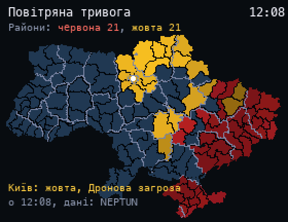

# Air Raid Alerts

A map of Ukraine with active air raid alerts by raion, coloured by the alert level introduced in September 2026: yellow for drones, red for missiles, ballistic and massed attacks. Raions where the alert just ended glow green for a few minutes. Your raion is marked with a ring and its status (with the threat type) is shown at the bottom: set it in `HOME` at the top of the script (default `м. Київ`, or e.g. `Львівський район`).

Data comes from the [NEPTUN](https://neptun.in.ua/developers) API, with [Tryvoha.online](https://tryvoha.online/api) as a fallback. Neither needs a key. Both are unofficial aggregators: use the official alerts and sirens for your safety.

## Install

Copy `wallpaper.lua` to the SD card as `/sd/wallpaper.lua` and connect to Wi-Fi in Keira. The data refreshes every 30 seconds, in the app and on the wallpaper (wallpapers need a recent Keira with network modules). On older firmware, open `/sd/wallpaper.lua` from the file manager to refresh. The last state is saved in `alerts.txt`, and the map turns grey when it is older than 15 minutes.

NEPTUN paints a raion when any of its hromadas or cities is under alert. Tryvoha.online skips hromada-only alerts and has no data for Crimea.

## Controls (app only)

| Button | Action |
| --- | --- |
| A | Refresh |
| START | Exit |

## Map

Raion and oblast borders are from NEPTUN ([raions.geojson](https://neptun.in.ua/raions.geojson), [oblasts.geojson](https://neptun.in.ua/oblasts.geojson)), baked into the script by `tools/gen_map.py`.
