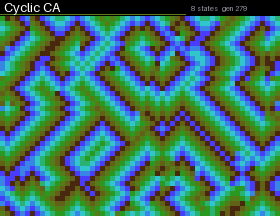

# Cellular Automata

Five cellular automata take turns every 30 seconds: Conway's Game of Life (cells colored by age, with fading trails), a cyclic automaton that grows spiral waves, Brian's Brain, three Langton's ants, and elementary 1D rules (30, 90, 110, 45, 150, 73, 105, 22) scrolling up the screen. The field wraps around at the edges. When Life or Brian's Brain dies out, new cells are seeded.

## Install

Copy `wallpaper.lua` to the SD card as `/sd/wallpaper.lua`. The launcher shows it on the home screen.

## Controls (app only)

| Button | Action |
| --- | --- |
| ← → | Previous / next automaton |
| B | Restart |
| A | Pause |
| START | Exit |
