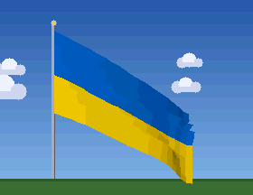

# Flag

The Ukrainian flag waving in the wind. The cloth is a grid of points connected by springs (Verlet integration); the wind changes strength and sometimes gusts. Folds are darker. Clouds drift across the sky.

## Install

Copy `wallpaper.lua` to the SD card as `/sd/wallpaper.lua`. The launcher shows it on the home screen.

## Controls (app only)

| Button | Action |
| --- | --- |
| B | Strong gust |
| A | Pause |
| START | Exit |
