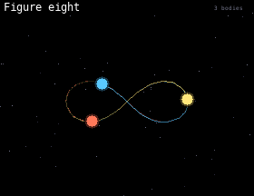

# Gravity

An n-body simulation with trails. Three scenes take turns: the figure-eight orbit of three equal bodies, a binary star with three planets and a comet, and a random cluster where bodies merge when they collide.

## Install

Copy `wallpaper.lua` to the SD card as `/sd/wallpaper.lua`. The launcher shows it on the home screen.

## Controls (app only)

| Button | Action |
| --- | --- |
| ← → | Previous / next scene |
| A | Pause |
| START | Exit |
