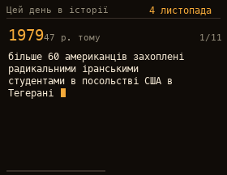

# On This Day

Selected events for today's date from Ukrainian [Wikipedia](https://uk.wikipedia.org/), shown one at a time and typed out like on a typewriter, with the year and how many years ago it was.

## Install

Copy `wallpaper.lua` to the SD card as `/sd/wallpaper.lua`. Connect to Wi-Fi in Keira, then open `/sd/wallpaper.lua` from the file manager once: the app downloads today's events into `history.txt`. With a recent Keira the wallpaper downloads new events when the day changes. On older firmware it keeps showing the saved day, so open the app again to refresh it.

## Controls (app only)

| Button | Action |
| --- | --- |
| ← → | Previous / next event |
| A | Refresh |
| START | Exit |
