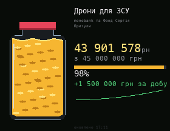

# Monobank Jar

A Monobank fundraising jar: the amount raised, the goal and progress, and the change over the last 24 hours with a small chart. Coins drop into the jar, and a handful falls when the amount grows. Data from `send.monobank.ua` (no API key).

Set your jar in `JARS` at the top of the script: the ID is the last part of the jar link, `send.monobank.ua/jar/XXXXXXXXXX`. You can list several jars, and they take turns every 15 seconds. The default is the "Дрони для ЗСУ" jar by monobank and the Serhiy Prytula Foundation.

## Install

Copy `wallpaper.lua` to the SD card as `/sd/wallpaper.lua`. Connect to Wi-Fi in Keira, then open `/sd/wallpaper.lua` from the file manager once: the app downloads the data into `jar_<ID>.txt`. With a recent Keira the wallpaper also refreshes it every 10 minutes. The 24-hour change appears once the wallpaper has been refreshing for at least 6 hours. On older firmware it only shows the saved data, so open the app again to refresh it.

This uses the endpoint behind the jar's web page, not an official API, so it may stop working if Monobank changes it.

## Controls (app only)

| Button | Action |
| --- | --- |
| ← → | Previous / next jar |
| A | Refresh |
| START | Exit |
