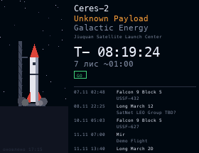

# Rocket Launches

The next rocket launches worldwide, from [Launch Library 2](https://thespacedevs.com/llapi) by The Space Devs (no API key). It shows a countdown to the next launch, with the rocket, mission, provider, launch site, status (GO, TBC, TBD, HOLD), orbit and weather chance. The next few launches are listed below, in Kyiv time. At T-0 the rocket on the pad lifts off.

## Install

Copy `wallpaper.lua` to the SD card as `/sd/wallpaper.lua`. Connect to Wi-Fi in Keira, then open `/sd/wallpaper.lua` from the file manager once: the app downloads the data into `launches.txt`. With a recent Keira the wallpaper also refreshes it every hour, and sooner once the listed launches have passed. Without a key the API allows 15 requests per hour. On older firmware it only shows the saved data, so open the app again to refresh it.

## Controls (app only)

| Button | Action |
| --- | --- |
| ← → | Which launch to show large |
| A | Refresh |
| START | Exit |
