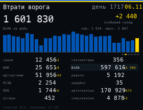

# Enemy Losses

Russian losses reported daily by the General Staff of the Armed Forces of Ukraine, from [russianwarship.rip](https://russianwarship.rip/) (no API key): personnel in large numbers, 12 kinds of equipment with the totals and the change since yesterday, and a chart of daily losses over the last 30 days. The chart shows a different category every 8 seconds (personnel, drones, artillery, vehicles, armored vehicles, tanks), and the matching cell is highlighted.

## Install

Copy `wallpaper.lua` to the SD card as `/sd/wallpaper.lua`. Connect to Wi-Fi in Keira, then open `/sd/wallpaper.lua` from the file manager once: the app downloads the data into `losses.txt`. With a recent Keira the wallpaper picks up the new report each morning (from 8:00 it checks every 20 minutes until the new report is out). On older firmware it only shows the saved data, so open the app again to refresh it.

## Controls (app only)

| Button | Action |
| --- | --- |
| ← → | Chart category |
| A | Refresh |
| START | Exit |
