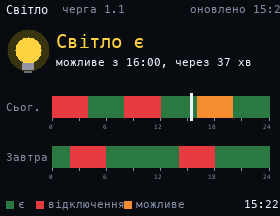

# Power Outages

The [YASNO](https://yasno.ua) planned power outage schedule for your group: bars for today and tomorrow, whether the power is on now, and how long until the next change. If YASNO switches to emergency shutdowns, it says so.

## Setup

Set `GROUP` at the top of `wallpaper.lua` to your group, as shown on the YASNO site (for example `"3.2"`). Kyiv is the default; for Dnipro set `REGION, DSO = 3, 301`.

The YASNO API is not documented, so the format of the outage slots may change.

## Install

Copy `wallpaper.lua` to the SD card as `/sd/wallpaper.lua`. Connect to Wi-Fi in Keira, then open `/sd/wallpaper.lua` from the file manager once: the app downloads the schedule into `outages.txt`. With a recent Keira the wallpaper also refreshes it every 15 minutes. On older firmware it only shows the saved schedule, so open the app again to refresh it.

## Controls (app only)

| Button | Action |
| --- | --- |
| A | Refresh |
| START | Exit |
