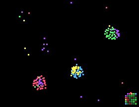

# Particle Life

Particles of five colors attract or repel each other according to a random table of rules, shown in the corner (green attracts, red repels). These simple rules produce cells, chains and moving "creatures". Every color always attracts its own kind, so structures form instead of dust. The rules change every 40 seconds.

## Install

Copy `wallpaper.lua` to the SD card as `/sd/wallpaper.lua`. The launcher shows it on the home screen.

## Controls (app only)

| Button | Action |
| --- | --- |
| B | New rules |
| A | Pause |
| START | Exit |
