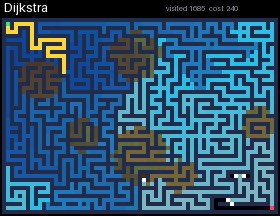

# Pathfinding

A maze is built step by step (recursive backtracker, Prim or Kruskal, taking turns), then gets a few loops and brown mud patches, where one step costs 5. Then BFS, DFS, Dijkstra, A* and greedy best-first search take turns finding a way from the green corner to the red one. Visited cells light up from blue to cyan in the order they were explored, and the found path is drawn in yellow. At the end a table compares the algorithms: how many cells each one visited and the cost of its path. Only Dijkstra and A* account for mud, so they always find the cheapest path.

## Install

Copy `wallpaper.lua` to the SD card as `/sd/wallpaper.lua`. The launcher shows it on the home screen.

## Controls (app only)

| Button | Action |
| --- | --- |
| ← → | Previous / next algorithm |
| B | New maze |
| A | Pause |
| START | Exit |
