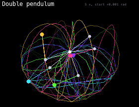

# Double Pendulum

Five double pendulums start almost the same way, only 0.001 radians apart. Within seconds they split apart and swing completely differently: this is chaos. Each one leaves a fading trail. They restart from a new position every 45 seconds.

## Install

Copy `wallpaper.lua` to the SD card as `/sd/wallpaper.lua`. The launcher shows it on the home screen.

## Controls (app only)

| Button | Action |
| --- | --- |
| B | Restart |
| A | Pause |
| START | Exit |
