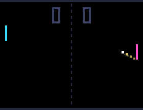

# Pong Bots

Two bots play table tennis. Each one predicts where the ball will arrive, including bounces off the walls, but aims with a small error that grows as the ball speeds up, so rallies end sooner or later. Games go to 7 points.

## Install

Copy `wallpaper.lua` to the SD card as `/sd/wallpaper.lua`. The launcher shows it on the home screen.

## Controls (app only)

| Button | Action |
| --- | --- |
| ↑ ↓ | Take over the left paddle (the bot comes back after 10 s without input) |
| A | Pause |
| START | Exit |
