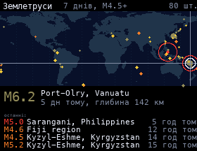

# Earthquakes

Earthquakes of magnitude 4.5+ from the past week, from [USGS](https://earthquake.usgs.gov/earthquakes/feed/), on a world map. Bigger circles are stronger quakes; red ones happened in the last 6 hours, orange today, yellow in the last 3 days. The newest one pulses. The strongest quakes are highlighted one at a time with the place, time and depth, and the latest four are listed below.

## Install

Copy `wallpaper.lua` to the SD card as `/sd/wallpaper.lua`. Connect to Wi-Fi in Keira, then open `/sd/wallpaper.lua` from the file manager once: the app downloads the data into `quakes.txt`. With a recent Keira the wallpaper also refreshes it every 30 minutes. On older firmware it only shows the saved data, so open the app again to refresh it.

The land map is baked into the script by `tools/gen_map.py` from [Natural Earth](https://www.naturalearthdata.com/) 110m land (public domain).

## Controls (app only)

| Button | Action |
| --- | --- |
| ← → | Previous / next highlighted quake |
| A | Refresh |
| START | Exit |
