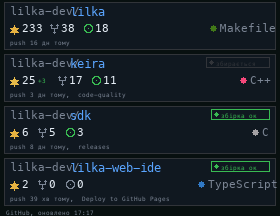

# GitHub Repos

Cards for a few GitHub repositories: stars (with how many were added today), forks, open issues and pull requests, the main language, the time of the last push, and whether the latest GitHub Actions run on the default branch passed. Data from the GitHub API without a key.

Set the repositories in `REPOS` at the top of the script (`owner/name`). Four fit on a screen; with more, the pages take turns every 12 seconds.

## Install

Copy `wallpaper.lua` to the SD card as `/sd/wallpaper.lua`. Connect to Wi-Fi in Keira, then open `/sd/wallpaper.lua` from the file manager once: the app downloads the data into `repos.txt`. With a recent Keira the wallpaper also refreshes it every 30 minutes. Without a key GitHub allows 60 requests per hour, and each repository takes 2. On older firmware it only shows the saved data, so open the app again to refresh it.

## Controls (app only)

| Button | Action |
| --- | --- |
| ← → | Previous / next page |
| A | Refresh |
| START | Exit |
