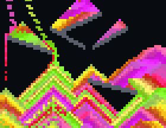

# Falling Sand

Invisible hands pour colored sand and water onto random stone ledges. Sand piles up in layers and sinks through water, and water spreads out flat. When the screen is half full, the floor opens and everything pours out. Then a new scene starts with new ledges and new colors.

## Install

Copy `wallpaper.lua` to the SD card as `/sd/wallpaper.lua`. The launcher shows it on the home screen.

## Controls (app only)

| Button | Action |
| --- | --- |
| B | Drain now |
| A | Pause |
| START | Exit |
