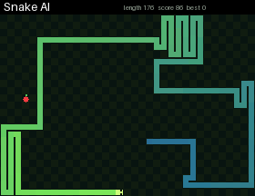

# Snake AI

A snake plays by itself. It finds the shortest path to the apple with BFS, but only takes it if it can still reach its own tail afterwards. Otherwise it follows its tail until a safe path opens up. It usually grows to well over a hundred cells.

## Install

Copy `wallpaper.lua` to the SD card as `/sd/wallpaper.lua`. The launcher shows it on the home screen.

## Controls (app only)

| Button | Action |
| --- | --- |
| Arrows | Take over and play yourself (the bot comes back after game over) |
| A | Pause |
| START | Exit |
