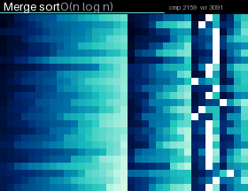

# Sorting

Sorting algorithms on a 2D gradient. Every row of the grid is shuffled into noise, then one algorithm sorts all rows at once until the gradient comes back. White cells are the ones being compared or moved. Algorithms take turns: bubble, quick, insertion, merge, selection, heap, cocktail shaker, shell, gnome, radix (LSD), odd-even and comb sort. Colors come in seven modes: ocean (the default), rainbow, hue 2D, corners, heat, pastel and mono. In the app you can switch between them.

## Install

Copy `wallpaper.lua` to the SD card as `/sd/wallpaper.lua`. The launcher shows it on the home screen.

## Controls (app only)

| Button | Action |
| --- | --- |
| ← → | Previous / next algorithm |
| ↑ ↓ | Previous / next color mode |
| A | Pause |
| START | Exit |
