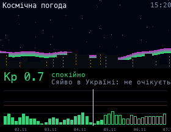

# Space Weather

The geomagnetic Kp index from [NOAA SWPC](https://www.swpc.noaa.gov/products/planetary-k-index) (no API key): the current value, the storm level (G0-G5), whether an aurora might be visible in Ukraine, and a chart of the last 3 days plus the forecast (outlined bars). The aurora above the city grows taller and brighter as Kp rises.

## Install

Copy `wallpaper.lua` to the SD card as `/sd/wallpaper.lua`. Connect to Wi-Fi in Keira, then open `/sd/wallpaper.lua` from the file manager once: the app downloads the data into `space.txt`. With a recent Keira the wallpaper also refreshes it every hour. On older firmware it only shows the saved data, so open the app again to refresh it.

## Controls (app only)

| Button | Action |
| --- | --- |
| A | Refresh |
| START | Exit |
