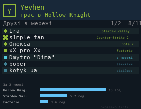

# Steam

Your Steam status and current game, the friends who are online (playing first, with the game), and your games over the last 2 weeks with hours played. If more friends are online than fit, the pages take turns every 6 seconds.

## Setup

Set two values at the top of the script:

- `KEY`: a Steam Web API key from [steamcommunity.com/dev/apikey](https://steamcommunity.com/dev/apikey).
- `STEAMID`: your SteamID64 (17 digits), which you can look up for example on [steamid.io](https://steamid.io/).

Your friend list and game details must be public in Steam's privacy settings, otherwise only your own status is shown. The key is stored on the SD card as plain text.

## Install

Copy `wallpaper.lua` to the SD card as `/sd/wallpaper.lua`. Connect to Wi-Fi in Keira, then open `/sd/wallpaper.lua` from the file manager once: the app downloads the data into `steam.txt`. With a recent Keira the wallpaper also refreshes statuses every 5 minutes, and the friend list and played games every hour. On older firmware it only shows the saved data, so open the app again to refresh it.

## Controls (app only)

| Button | Action |
| --- | --- |
| A | Refresh |
| START | Exit |
