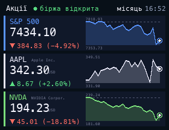

# Stocks

The S&P 500, Apple and NVIDIA with the price, the change and a chart for the chosen period, from Yahoo Finance (no API key). Periods: 1 hour, day, 5 days, month (default), 6 months, year, 5 years. The change is counted from the close before the period (for the hour, from its first price), shown as the dashed line. The header shows whether the US market is open. To change the tickers, edit `SYMBOLS` at the top of the script; any Yahoo Finance ticker works (for example `^IXIC`, `MSFT`, `TSLA`).

## Install

Copy `wallpaper.lua` to the SD card as `/sd/wallpaper.lua`. Connect to Wi-Fi in Keira, then open `/sd/wallpaper.lua` from the file manager once: the app downloads the data into `stocks.txt`. With a recent Keira the wallpaper also refreshes it one ticker at a time: every 2 minutes for the hour, up to every 6 hours for 5 years. The chosen period is saved in `stocks.txt` too, so the wallpaper keeps it. To change the default, edit `PERIOD`. On older firmware it only shows the saved data, so open the app again to refresh it.

Yahoo Finance has no official public API, so this may stop working if Yahoo changes it.

## Controls (app only)

| Button | Action |
| --- | --- |
| ← → | Change the period |
| A | Refresh |
| START | Exit |
