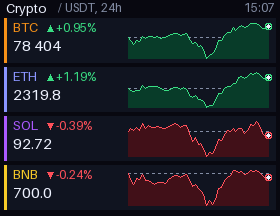

# Crypto Ticker

BTC, ETH, SOL and BNB prices in USDT with the 24-hour change and a 24-hour chart, from the public [Binance market data API](https://developers.binance.com/docs/binance-spot-api-docs/rest-api) (no API key). The dashed line marks the price 24 hours ago. To change the coins, edit `COINS` at the top of the script.

## Install

Copy `wallpaper.lua` to the SD card as `/sd/wallpaper.lua`. Connect to Wi-Fi in Keira, then open `/sd/wallpaper.lua` from the file manager once: the app downloads the data into `ticker.txt`. With a recent Keira the wallpaper also refreshes one coin at a time every 5 minutes. On older firmware it only shows the saved data, so open the app again to refresh it.

## Controls (app only)

| Button | Action |
| --- | --- |
| A | Refresh |
| START | Exit |
