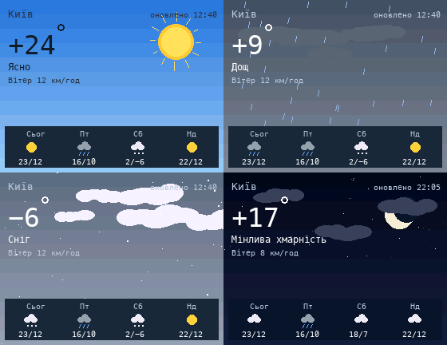

# Weather

Current weather from [Open-Meteo](https://open-meteo.com) as an animated scene (sun, clouds, rain, snow, fog, storm) with a 4-day forecast.

## Install

Copy `wallpaper.lua` to the SD card as `/sd/wallpaper.lua`. Connect to Wi-Fi in Keira, then open `/sd/wallpaper.lua` from the file manager once: the app downloads the data into `weather.txt`. The wallpaper only reads that file (the launcher can't make network requests), so open the app again from time to time to refresh it.

## City

By default the city is found from your IP address (via [ipwho.is](https://ipwho.is), no key); with a VPN that is the VPN server's city. To choose a city, set its name in `CITY` at the top of the script, for example `local CITY = "Львів"`: [Open-Meteo geocoding](https://open-meteo.com/en/docs/geocoding-api) finds it.

Examples that work: `"Київ"`, `"Харків"`, `"Одеса"`, `"Дніпро"`, `"Запоріжжя"`, `"Львів"`, `"Ужгород"`, `"Чернігів"`, `"Біла Церква"`, `"Ірпінь"`, `"Кам'янець-Подільський"`, `"Буковель"`, `"Варшава"`, `"Berlin"`, `"London"`, `"New York"`, `"Toronto"`.

Ukrainian names work best: common English ones like `"Kyiv"`, `"Lviv"` or `"Odesa"` are found too, but some transliterations are not (`"Kamianske"`). When several cities share a name, the largest one wins: `"Alexandria"` is in Egypt, `"Олександрія"` is in Ukraine.

Cities abroad work too: day and night, "today" in the forecast and the clock follow the city's own time zone, and when it differs from the Lilka's clock the screen shows the local time there ("Там зараз 09:59").

## Controls (app only)

| Button | Action |
| --- | --- |
| A | Refresh |
| START | Exit |
